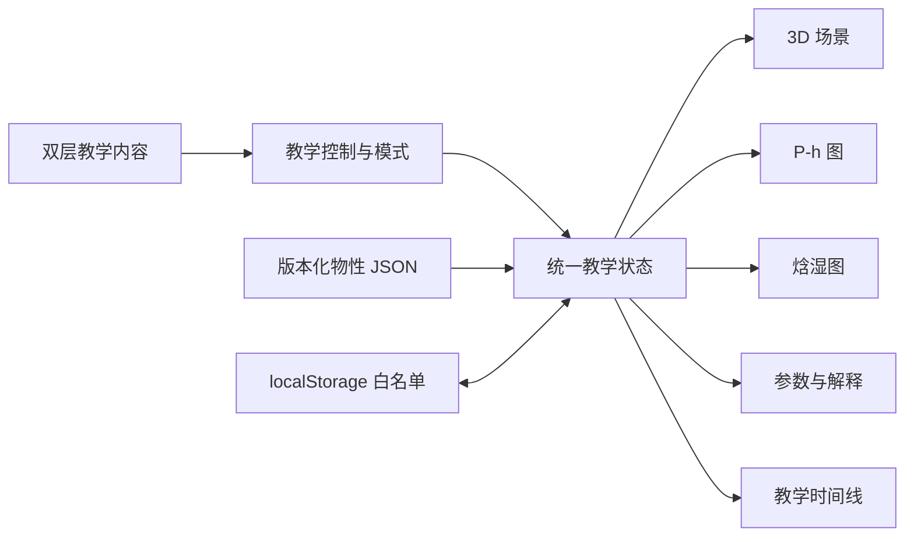
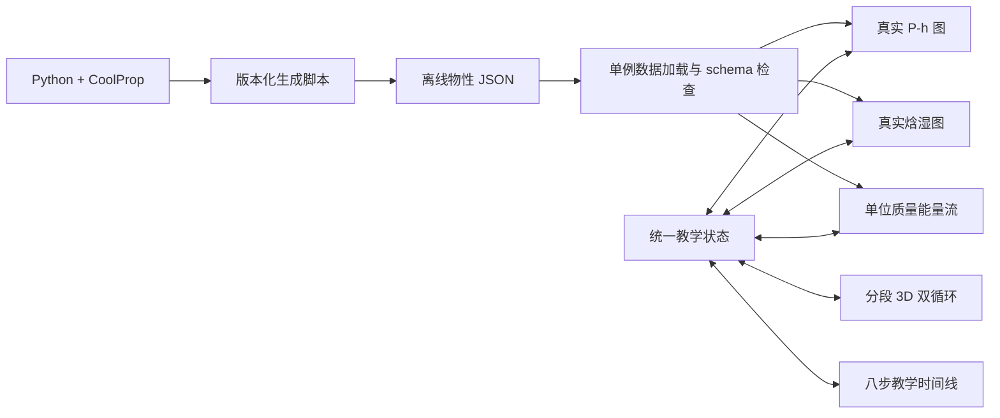

# 系统架构与阶段实现

状态：阶段 1、2 已验收；阶段 3 双循环与物理联动已实现并等待验收。

## 产品边界

- 静态前端，第一版不要求 Python 服务。
- 数据是可追溯的离散教学工况，不冒充实机标定或连续动态仿真。
- 动画时间只控制教学进度和视觉插值，不映射真实烘干时长。
- 3D 内部结构在无 CAD、拆机尺寸或厂商授权资料时统一标记为“教学示意”。
- 物性 JSON 由阶段 3 的固定脚本生成，页面只读取版本化静态文件。

## 模块关系



## 建议目录

```text
src/
  animations/    教学插值与统一时间线
  charts/        P-h 图、焓湿图和能量流
  components/    工作台、导航、设置与通用 UI
  content/       中英术语、基础讲解与工程深入
  models/        三类机型的程序化模型定义
  scene/         R3F 场景、相机、灯光、标签与剖切
  state/         单一教学状态与 localStorage 白名单
  thermo/        JSON 类型、单位转换和一致性校验
public/
  data/          预计算物性和来源元数据
  models/        经许可审查的模型资产
scripts/physics/ 物性生成与验证脚本
tests/           单元、同步和端到端测试
docs/            来源、审查、验收和维护记录
```

## 统一状态原则

统一状态至少包含：机型、教学/自由模式、基础/工程层级、当前步骤、播放状态、倍速、循环可见性、选中部件、图表选中过程、视角模式、透明/剖切/爆炸参数、画质档位和全屏恢复快照。

3D、图表和参数面板只订阅同一状态；组件不得各自启动独立计时器。图表点击和部件点击都转换成同一领域事件，例如 `selectProcess('2-3')` 或 `selectComponent('condenser')`。

## 数据契约

每个物性 JSON 至少保存：

- 工质或湿空气模型、输入假设和 SI 单位
- CoolProp 版本、生成脚本版本、生成时间和来源链接
- 状态点、过程、适用相区和字段可用性
- 一致性检查结果与容差
- `teachingScenario` 标记，防止误解为实测数据

## 性能策略

- 阶段 1 只用低面数程序化几何验证交互路径。
- 阶段 2 开始使用实例化、LOD、粒子上限和按需渲染。
- 画质档位控制抗锯齿、阴影、像素比、粒子数量和后处理。
- 目标是普通 Windows Chrome/Edge 上流畅交互，不承诺所有硬件恒定 60 FPS。

## 阶段 1 已落地模块

- `src/models/catalog.ts`：三种机型的领域定义与中英术语。
- `src/state/teachingStore.ts`：Zustand 单一状态、过程/部件映射和 localStorage 白名单。
- `src/animations/useTeachingClock.ts`：唯一教学动画时钟，进度明确不映射真实烘干时间。
- `src/scene/`：R3F 程序化占位模型、OrbitControls 和两类流动粒子。
- `src/charts/`：可点击的 P-h 与焓湿图 SVG 占位，明确不含物性数值。
- `src/components/`：三机型入口、教学步骤、播放控制、参数边界与工作台布局。

3D 场景采用 React `lazy` 延迟加载。最终构建中初始 UI JavaScript 为 237.56 kB，WebGL 场景独立块为 932.38 kB（均为 gzip 前大小）。场景块仍触发 Vite 500 kB 警告，作为后续优化项保留，不将警告隐藏。

## 阶段 2 模型实现

- `src/models/engineering.ts` 是三机型部件清单、空气路径和热泵冷媒拓扑的可测试单一事实源。
- `src/scene/EngineeringMachine.tsx` 用共享机壳、滚筒、风机、换热器、管路与标签原语组合三类机型。
- 结构模式用同一场景实例改变机壳可见性、材质透明度与部件目标位置；爆炸布局通过阻尼插值平滑切换，不重建整套场景。
- 相机预设只在选择后驱动到目标位，完成后恢复 OrbitControls 自由旋转；避免预设持续覆盖用户操作。
- 标签为本地 CanvasTexture 精灵，随部件移动并始终面向相机；默认只显示优先部件或当前选中部件，以减少遮挡。
- 全屏采用浏览器窗口内固定覆盖层，不销毁 Canvas 或统一状态，因此退出后保留布局、相机和播放状态。

## 阶段 3 数据与同步



- Python 只在构建/维护时运行，静态前端不依赖 Python 后端。
- JSON 是图表、参数表和能量流的唯一数值来源；图中状态点与右侧数值不各自维护副本。
- `selectedProcess`、`selectedComponent`、`step`、`circuit` 和 `teachingProgress` 在单次领域动作中同步更新。
- P-h/焓湿状态点、能量按钮、3D 部件与教学步骤使用同一过程标识；点击任一入口都会高亮对应消费者。
- 双循环的所有稳态段同时运动，教学步骤仅改变强调对象，不暗示部件按步骤启停。

## 阶段 4 发布候选架构

- `src/content/comparison.ts` 和 `src/content/explanations.ts` 将工程内容与视图组件解耦；基础/深入只改变信息密度，不改变物理数据。
- `KnowledgeDrawer` 承载三机型十维对比和参考/版权信息，避免主工作台常态拥挤。
- `quality.ts` 把自动画质决策写成无副作用纯函数：减少动态偏好优先，其次参考 DPR、逻辑核数和可用的设备内存提示。
- 画质档位统一影响 Canvas DPR、抗锯齿、电源偏好、阴影和粒子数量；不会改变物性点或拓扑。
- localStorage 只持久化显示和学习进度白名单，不保存用户身份、令牌或浏览器测得的伪传感器值。
- 生产静态站只需 `dist/`；CoolProp 和 Python 保留为离线数据生成工具，不进入运行时。
- 浏览器兼容层以 Windows 系统 Chrome/Edge 为验收目标；资源错误、控制台、页面异常与 WebGL 运行状态由 Playwright 同时收集。

